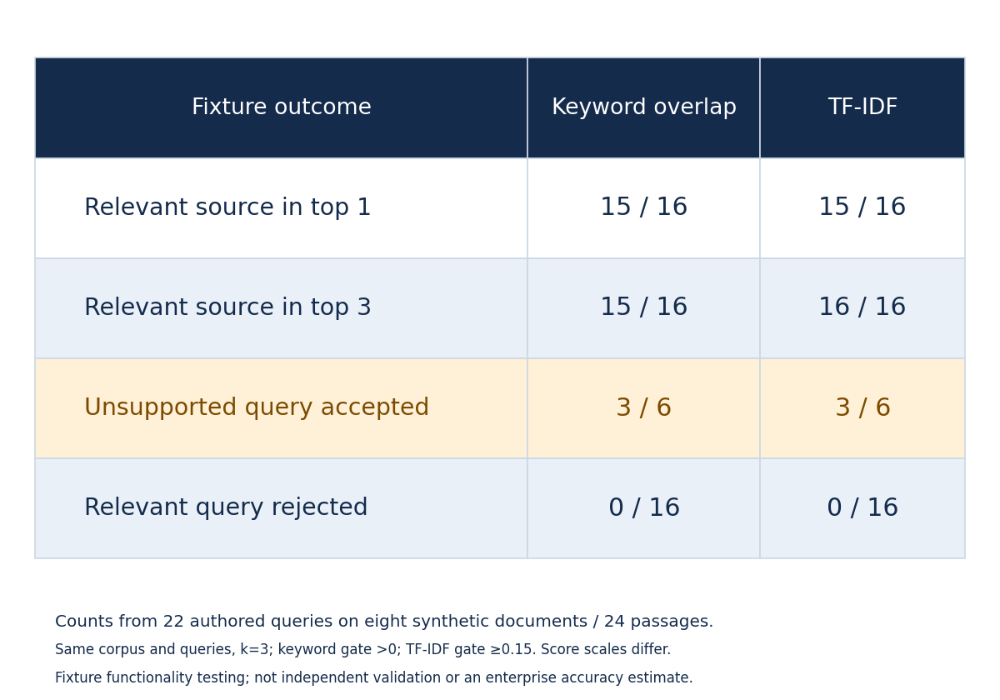
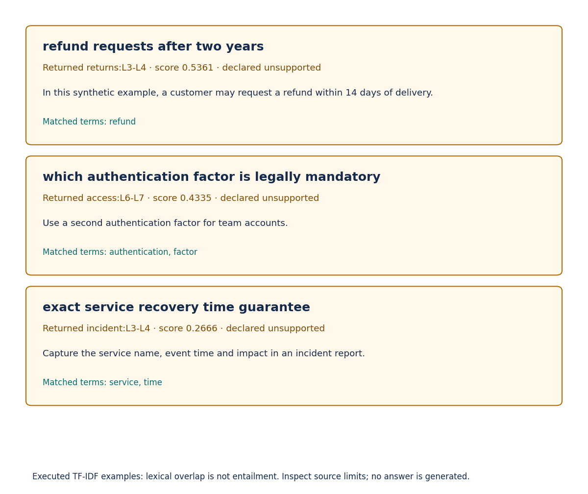
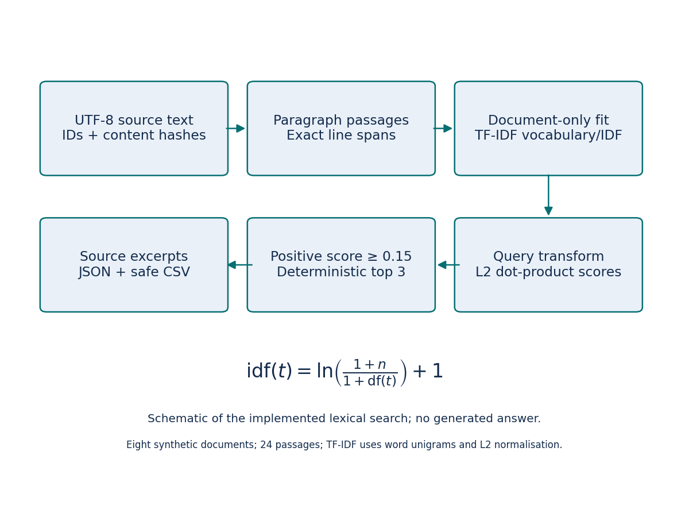

# Document Evidence Inspector

A small local document-search app for business knowledge teams and developers who need to inspect the original passage behind a search result. Search your own UTF-8 `.txt`/`.md` files, review exact source lines and document hashes, and export the evidence as JSON or CSV.

**Local-only release.** No hosted demo, generated answers, API key, model download or third-party document transmission. Established lexical retrieval: TF-IDF and a transparent keyword baseline. A search score measures lexical similarity; it does not prove that a passage answers a question.

## Run it

Python 3.12 is the tested runtime. From this repository:

```sh
python -m venv .venv
# Windows: .venv\Scripts\activate
# macOS/Linux: source .venv/bin/activate
python -m pip install -r requirements.txt
python app.py --port 8765
```

Open **http://127.0.0.1:8765**. The server binds only to loopback. It is a development tool, not production hosting. Stop it with Ctrl+C. A second instance cannot share the same listening port.

1. Keep the eight included synthetic example documents, or select your UTF-8 text/Markdown files.
2. Enter `restore deleted project` and choose TF-IDF.
3. Inspect the returned `backup:L6-L7` passage, score, matched terms and document SHA-256.
4. Export JSON or CSV to preserve the exact report. Confirm the source meaning before acting on a match.

The file importer supports up to 20 documents, 50,000 UTF-8 bytes per file and 500,000 total. Source IDs must be unique lowercase ASCII identifiers. Queries are limited to 1,000 characters. PDFs, office documents, semantic embeddings and multilingual relevance are outside this release.

## CLI and checks

```sh
python search.py --query "restore deleted project" --output local-output/example
python -m unittest -v test_search.py
python evaluate.py --output local-output/reproduction
python render_figures.py
```

The CLI creates `.json` and `.csv` reports. The evaluation command checks the saved input hashes before reporting outcomes. The fixture suite is deterministic; it does not need a random seed. Figure rendering uses the archived experiment results. Keep new reruns in `local-output/` to preserve the original record.

## Checked results — 14 October 2026

Eight authored synthetic documents, 24 passages, 16 relevant queries and six unsupported queries; two development queries are excluded. All **40 automated correctness, numerical, export and HTTP checks passed**, with zero skips.

| Outcome | Keyword baseline | TF-IDF |
| --- | ---: | ---: |
| Relevant source in first result | 15/16 | 15/16 |
| Relevant source among first three | 15/16 | 16/16 |
| Relevant queries rejected | 0/16 | 0/16 |
| Unsupported queries accepted | 3/6 | 3/6 |

TF-IDF uses a fixed 0.15 gate; keyword matching accepts any positive overlap. Their score scales differ, and the gates are not calibrated to equal acceptance. One top-three difference on these fixtures is not evidence of general superiority.



The three unsupported TF-IDF matches expose a useful limit: a two-year refund question matches a 14-day policy; a legal-mandate question matches a synthetic authentication procedure; a recovery-guarantee question matches an incident-reporting instruction. The app deliberately shows the excerpt instead of treating the score as proof.



## How it works

Paragraphs are split into passages of at most eight original source lines, without overlap. The vectorizer is fitted only on document passages. It uses English word unigrams, Unicode accent stripping, English stop words, smooth IDF and L2 normalization. A dot product gives cosine similarity. Positive matches passing the fixed gate are ranked, with deterministic source-ID/line tie-breaking. Each record retains the exact excerpt, original line span, matched terms, score and decoded-text SHA-256.



Browser checks covered actual search, an unseen-vocabulary no-result case, native JSON/CSV downloads matching the API/CLI, escaped literal HTML, labelled controls and keyboard focus. A narrow viewport showed no horizontal overflow; its screenshot capture was unavailable, so this is not a full mobile or accessibility certification.

## Reproduce and inspect

- [Declared protocol](PROTOCOL.md), [configuration](config.json) and [input hashes](declared-inputs.json).
- [All 44 per-query method reports](experiments/2026-10-14/query-results.json), [aggregate results/environment](experiments/2026-10-14/results.json) and saved stdout.
- [Implementation corrections](experiments/2026-10-14/implementation-notes.md) preserve earlier runs and distinguish repairs from evaluation tuning.
- [Sources, versions and licences](sources.json); editable SVG figures and `render_figures.py`.

## Limits and data handling

These are hand-authored functionality fixtures visible during development, not independent enterprise validation. Lexical matching misses synonyms and does not reason reliably about negation, dates, quantities or policy conditions. The fixed threshold is uncalibrated. This release makes no latency, business-impact, adoption or security-audit claim.

Source files remain on your machine. The browser sends text only to the loopback Python process. There are no external assets, model calls or query logs. HTML is rendered as text; formula-like CSV cells are prefixed for spreadsheet safety. Host/origin, size and path checks reduce accidental misuse, but this lightweight server must not be exposed as a public service.

Code and all authored synthetic example documents/queries are available under the [MIT licence](LICENSE). Third-party dependencies keep their own licences. No private, customer or employer material is included.
